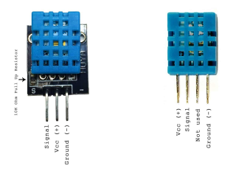
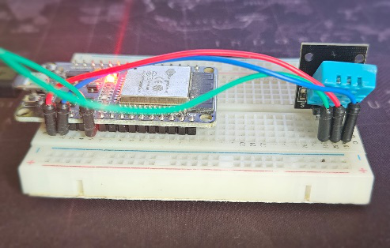
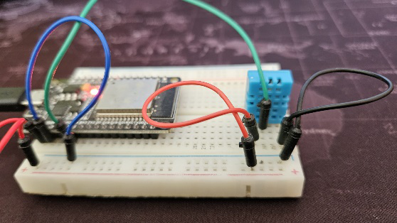
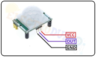
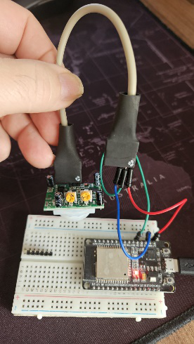
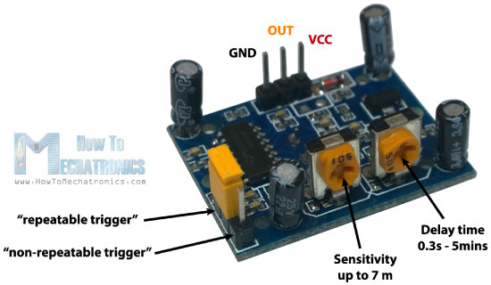
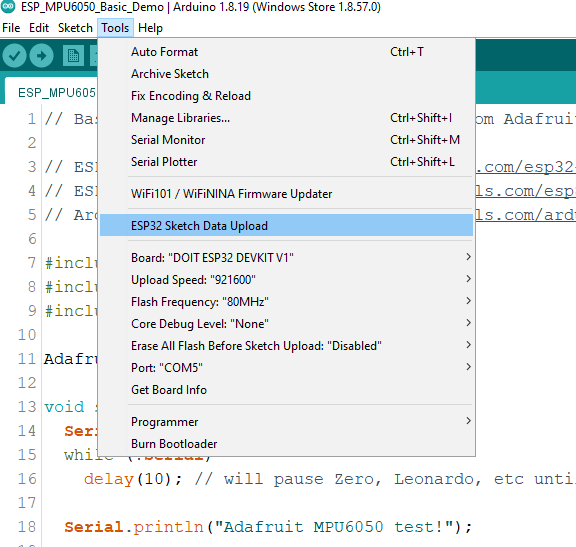
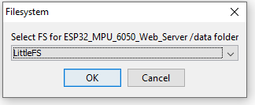

# Laboratorul 3 — Senzori și interfețe web cu ESP32

**Sisteme dedicate pentru IoT • Îndrumător practic pentru studenți**

DHT11 • PIR • MPU6050 pe GY-87 • LittleFS • vizualizare 3D

Ediție pentru activitatea de laborator din 13 octombrie 2026.

[Înapoi la pagina laboratorului](../README.md) · [PDF corectat](Laborator_03.pdf)

Material elaborat pe baza laboratorului 3 din îndrumătorul furnizat, cu toate cele 8 figuri originale ale acestui laborator și cu explicații în limba română. Cele cinci taskuri păstrează ordinea și cerințele din documentul de referință. Proiectele complete sunt în [directorul cod](../cod/).

**Rezultatul lucrării:** veți citi senzori digitali, veți publica măsurări într-o pagină web, veți trata evenimente prin întreruperi și veți transmite date de mișcare către o reprezentare 3D.

**Parcurs:** T1 verifică DHT11; T2 reutilizează montajul; T3 înlocuiește DHT11 cu PIR; T4 verifică MPU6050; T5 reutilizează montajul I2C și adaugă interfața web.

Codurile sunt destinate unei plăci ESP32 clasice cu GPIO 2, 4, 21 și 22 accesibile. Pentru ESP32-C3/S3 sau alte variante se verifică și se adaptează pinii, LED-ul și opțiunile USB.

**Verificare înaintea orei:** profesorul încarcă proiectele pe un kit și confirmă placa, alimentarea modulelor, bibliotecile și rețeaua disponibilă. Codul acestei ediții a fost revizuit static; nu a fost compilat sau testat pe echipamentul fizic în această sesiune.

## Cuprins

- [1. Pregătirea laboratorului](#sectiunea-1)

- [2. Taskul 1 — DHT11: temperatură și umiditate în terminal](#sectiunea-2)

- [3. Taskul 2 — DHT11: server web de măsurare](#sectiunea-3)

- [4. Taskul 3 — PIR: întreruperi și temporizare](#sectiunea-4)

- [5. Taskul 4 — MPU6050 din GY-87: accelerație și rotație](#sectiunea-5)

- [6. Taskul 5 — MPU6050: server web și model 3D](#sectiunea-6)

- [7. Fișa de rezultate și verificarea finală](#sectiunea-7)

- [8. Surse și corespondența cu îndrumătorul original](#sectiunea-8)

<a id="sectiunea-1"></a>

## 1. Pregătirea laboratorului

### 1.1. Echipamente și organizare

Pentru fiecare echipă: ESP32 și cablu USB de date, breadboard, conductoare, DHT11, PIR HC-SR501, modul GY-87 cu MPU6050 și calculator cu Arduino IDE. Pentru DHT11 fără placă adaptor este necesar un rezistor de aproximativ 10 kΩ între DATA și 3,3 V. Modulul DHT11 cu trei pini poate avea deja rezistorul montat.

Lucrați cu alimentarea oprită când mutați firele. Verificați inscripțiile de pe module înainte de conectare: ordinea pinilor diferă între plăci. Intrările ESP32 folosesc logică de 3,3 V; nu conectați un semnal de 5 V direct la GPIO. Toate componentele montajului trebuie să aibă masă comună.

**GPIO 4 este reutilizat:** DHT11 se deconectează înainte de montarea PIR. Nu legați cele două ieșiri pe același pin. Pinul D4 din cerința originală este interpretat aici ca GPIO 4; verificați serigrafia plăcii.

### 1.2. Arduino IDE și biblioteci

În Boards Manager instalați platforma esp32 de la Espressif Systems. Selectați modelul real al plăcii și portul USB. Pentru un ESP32 DevKit clasic, profilul ESP32 Dev Module poate fi potrivit; nu îl folosiți automat pentru o placă S3/C3. Notați în raport versiunile IDE, platformei ESP32 și bibliotecilor.

În Library Manager căutați numele de mai jos și acceptați instalarea dependențelor. Nu păstrați simultan copii vechi și noi ale aceleiași biblioteci în directoare diferite.

| Task | Biblioteci de instalat | Configurație esențială |
| --- | --- | --- |
| T1 | DHT sensor library — Adafruit; Adafruit Unified Sensor | DHT11, GPIO 4; Serial 9600 |
| T2 | Cele de la T1; ESPAsyncWebServer — ESP32Async; AsyncTCP — ESP32Async | Wi-Fi 2,4 GHz; Serial 115200 |
| T3 | Arduino ESP32; driverul GPIO este inclus | PIR GPIO 4; LED GPIO 2; Serial 115200 |
| T4 | Adafruit MPU6050; Adafruit Unified Sensor; Adafruit BusIO | SDA 21, SCL 22; Serial 115200 |
| T5 | Cele de la T4; ESPAsyncWebServer; AsyncTCP; Arduino_JSON | LittleFS și Wire incluse în platforma ESP32 |

Arduino_JSON și ArduinoJson sunt biblioteci diferite. Pentru codul furnizat se instalează **Arduino_JSON**. Pentru server se folosesc proiectele întreținute de **ESP32Async**, indicate în sursele laboratorului.

### 1.3. Deschiderea proiectelor și monitorul serial

Descărcați repository-ul prin Code → Download ZIP și dezarhivați-l, sau folosiți git clone. În cod/ există câte un folder pentru fiecare task. Deschideți fișierul .ino din folderul corespunzător; numele folderului coincide cu numele sketch-ului. Nu combinați cele cinci sketch-uri în același proiect.

Apăsați Verify, apoi Upload. Deschideți Serial Monitor, selectați viteza taskului și apăsați EN/RESET pentru a revedea mesajele inițiale. T1 folosește 9600 baud; T2–T5 folosesc 115200 baud. Nu confundați viteza de upload cu viteza monitorului.

Dacă terminalul rămâne gol, verificați portul care apare/dispare la conectarea plăcii, cablul de date, închiderea altui program care folosește portul și butonul RESET. La variante cu USB nativ verificați opțiunea USB CDC On Boot conform plăcii; aceasta nu este o setare universală pentru ESP32 clasic cu convertor USB–serial.

### 1.4. Rețeaua pentru T2 și T5

Calculatorul sau telefonul și ESP32 trebuie să fie în aceeași rețea locală, cu acces între clienți. Folosiți o rețea de laborator de 2,4 GHz; rețelele cu portal de autentificare sau cu izolarea clienților pot împiedica demonstrația. IP-ul se citește după fiecare pornire; nu presupuneți că rămâne același.

În fiecare dintre proiectele T2 și T5 există lab_config.h. Completați local WIFI_SSID și WIFI_PASS. Păstrați ghilimelele. Nu introduceți parola reală în raport sau într-un repository public. Fișierul comun limitează încercarea de conectare la 20 de secunde și afișează motivul general al opririi.

[Fișier Arduino: T2_DHT_Web/lab_config.h](../cod/T2_DHT_Web/lab_config.h)

```cpp
#pragma once
#include <WiFi.h>
// Completati local. Nu publicati parola in repository.
const char* WIFI_SSID = "NUMELE_RETELEI";
const char* WIFI_PASS = "PAROLA_RETELEI";
bool conectareWiFi() {
  WiFi.mode(WIFI_STA);
  WiFi.begin(WIFI_SSID, WIFI_PASS);
  Serial.print("Conectare Wi-Fi");
  const uint32_t start = millis();
  while (WiFi.status() != WL_CONNECTED && millis() - start < 20000) {
    delay(250); Serial.print('.');
  }
  if (WiFi.status() != WL_CONNECTED) {
    Serial.println("\nWi-Fi indisponibil. Verificati SSID/parola; RESET.");
    return false;
  }
  Serial.print("\nDeschideti http://"); Serial.println(WiFi.localIP());
  return true;
}
```
<a id="sectiunea-2"></a>

## 2. Taskul 1 — DHT11: temperatură și umiditate în terminal

**Obiectiv:** realizați un montaj DHT11 și validați achiziția înainte de folosirea rețelei. Sursa indicată: [S1]; biblioteci: [S6], [S7].

### 2.1. Principiu și conexiuni

DHT11 livrează digital temperatura și umiditatea relativă. Pinul DATA nu se citește cu analogRead: biblioteca gestionează secvența de comunicație și verificarea datelor. Umiditatea relativă se exprimă în procente; temperatura citită implicit de bibliotecă este în grade Celsius. Un rezultat NaN indică o citire nereușită, nu o temperatură egală cu zero.

În această lucrare se folosește **DHT11**, chiar dacă titlul tutorialului menționează și DHT22. Selectarea unui model greșit poate produce erori. Citirea la două secunde este suficientă pentru demonstrație și evită solicitarea repetată inutilă a senzorului.

| Semnal | Conexiune ESP32 | Observație |
| --- | --- | --- |
| VCC / + | 3V3 | Pentru configurația DHT11 din acest ghid |
| DATA / S | GPIO 4 | Firul verde din cerința originală |
| GND / − | GND | Masă comună |
| NC | Neconectat | Doar la senzorul fără modul, cu patru pini |

La senzorul cu patru pini, privind fața cu grilaj și pinii orientați în jos, figura 1 indică VCC, DATA, NC, GND. La modulul cu trei pini urmați inscripțiile propriei plăci. Rezistorul de pull-up se montează între DATA și 3V3 dacă nu există deja pe modul.



Figura 1. DHT11 fără adaptor și modul DHT11: identificarea pinilor. Figură păstrată din îndrumătorul original.



Figura 2. Fotografia originală a montajului DHT11–ESP32. Pentru executarea conexiunilor prevalează tabelul și inscripțiile pinilor; culoarea firului nu identifică electric semnalul.



Figura 3. A doua fotografie originală a montajului. Identificați VCC, DATA și GND înainte de alimentare.

### 2.2. Procedură

1. Opriți alimentarea, realizați cele trei conexiuni și verificați existența rezistorului de pull-up.

2. Instalați DHT sensor library și Adafruit Unified Sensor. Deschideți T1_DHT11.ino.

3. Verificați DHT_PIN = 4 și DHT_TYPE DHT11. Nu lăsați activă o selecție DHT22 dintr-un alt exemplu.

4. Compilați, încărcați și deschideți Serial Monitor la 9600 baud. Apăsați RESET; după mesajul de pornire apar citiri la aproximativ două secunde.

5. Notați zece perechi temperatură–umiditate. Apropiați mâna fără a atinge contactele și observați răspunsul. Evitați condensul și încălzirea puternică a senzorului.

### 2.3. Cod complet

[Fișier Arduino: T1_DHT11/T1_DHT11.ino](../cod/T1_DHT11/T1_DHT11.ino)

```cpp
#include <DHT.h>
constexpr uint8_t DHT_PIN = 4;
#define DHT_TYPE DHT11
DHT dht(DHT_PIN, DHT_TYPE);
void setup() {
  Serial.begin(9600);
  delay(1000);
  Serial.println("Task 1 - DHT11 pe GPIO 4");
  dht.begin();
}
void loop() {
  delay(2000);
  float h = dht.readHumidity();
  float t = dht.readTemperature();
  if (isnan(h) || isnan(t)) {
    Serial.println("Eroare DHT: verificati firele si tipul DHT11.");
    return;
  }
  Serial.printf("T = %.1f C; RH = %.1f %%\n", t, h);
}
```

setup() inițializează portul serial și obiectul DHT. loop() așteaptă două secunde, citește cele două mărimi și respinge perechea dacă oricare valoare este NaN. return oprește numai iterația curentă din loop(); programul va încerca din nou.

### 2.4. Verificare și rezultat de predat

În terminal trebuie să apară linii de forma T = ... C; RH = ... %. Valorile numerice se completează cu măsurările proprii, nu cu valori impuse. Dacă apar erori, verificați ordinea pinilor, masa comună, GPIO 4, tipul DHT11 și rezistorul. Dacă apar caractere ilizibile, corectați viteza monitorului.

Predați o fotografie a montajului, captura cu minimum zece citiri și tabelul cu minim, maxim și medie pentru fiecare mărime. Explicați de ce un senzor digital necesită totuși un protocol și o bibliotecă și de ce NaN nu trebuie inclus în medie.

<a id="sectiunea-3"></a>

## 3. Taskul 2 — DHT11: server web de măsurare

**Obiectiv:** afișați în browser măsurările deja validate la T1. Sursa indicată: [S2]; componentele serverului: [S8], [S9]. Montajul și senzorul rămân cele de la T1.

### 3.1. Cum circulă datele

ESP32 citește DHT11 o dată la două secunde și păstrează rezultatul. Browserul solicită pagina HTML prin ruta /, apoi cere periodic /date. Serverul răspunde cu un obiect JSON care conține t și h. JavaScript actualizează textul paginii fără reîncărcarea documentului.

Citirea senzorului are loc în loop(), nu în callback-ul unei cereri web. Astfel, deschiderea paginii de către doi studenți nu dublează frecvența fizică de citire a DHT11. O secțiune critică scurtă protejează perechea de valori partajată între achiziție și serverul asincron. Accesul la senzor și trimiterea răspunsului sunt în afara acestei secțiuni.

Răspunsul 503 semnalează lipsa unei citiri valide. Pagina afișează indisponibilitatea senzorului și nu prezintă o valoare veche ca și cum ar fi nouă. Exemplul este un server local de laborator, fără autentificare.

### 3.2. Procedură

1. Confirmați mai întâi funcționarea T1. Păstrați DHT11 pe GPIO 4 și opriți alimentarea înaintea oricărei corectări a firelor.

2. Deschideți T2_DHT_Web.ino și completați lab_config.h din același folder. Instalați ESPAsyncWebServer și AsyncTCP din organizația ESP32Async.

3. Compilați și încărcați. Schimbați Serial Monitor la **115200 baud** și apăsați RESET.

4. Citiți adresa după mesajul Deschideti http://. Introduceți exact http://IP în browser, fără https. Primele două secunde pot afișa așteptare sau senzor indisponibil.

5. Deschideți http://IP/date într-o filă separată. Verificați că răspunsul include t și h și că valorile corespund celor din terminal.

6. Urmăriți actualizarea timp de cel puțin 30 de secunde. Deschideți pagina pe un al doilea dispozitiv din aceeași rețea și comparați afișarea.

### 3.3. Cod complet

Fișierul lab_config.h este cel prezentat la pregătire și este inclus separat în acest proiect.

[Fișier Arduino: T2_DHT_Web/T2_DHT_Web.ino](../cod/T2_DHT_Web/T2_DHT_Web.ino)

```cpp
#include "lab_config.h"
#include <DHT.h>
#include <AsyncTCP.h>
#include <ESPAsyncWebServer.h>
DHT dht(4, DHT11);
AsyncWebServer server(80);
portMUX_TYPE mux = portMUX_INITIALIZER_UNLOCKED;
float temperatura = 0, umiditate = 0;
bool valid = false;
uint32_t ultimaCitire = 0;
const char pagina[] PROGMEM = R"HTML(
<!doctype html><html lang="ro"><meta charset="utf-8">
<meta name="viewport" content="width=device-width,initial-scale=1">
<title>DHT11 - Laborator 3</title>
<style>body{font:22px Arial;margin:3rem;line-height:1.6}</style>
<h1>ESP32 + DHT11</h1><p id="valori">Astept citirea...</p>
<script>
async function actualizeaza(){
 const e=document.getElementById('valori');
 try {
  const r=await fetch('/date',{cache:'no-store'});
  if(!r.ok) throw new Error('Senzor indisponibil');
  const d=await r.json();
  e.textContent=`Temperatura: ${d.t} °C; umiditate: ${d.h} %`;
 } catch(err){e.textContent=err.message;}
}
actualizeaza();setInterval(actualizeaza,2000);
</script></html>)HTML";
void setup() {
  Serial.begin(115200); delay(1000);
  Serial.println("Task 2 - DHT11 web"); dht.begin();
  if (!conectareWiFi()) return;
  server.on("/", HTTP_GET, [](AsyncWebServerRequest* r) {
    r->send(200, "text/html; charset=utf-8", pagina);
  });
  server.on("/date", HTTP_GET, [](AsyncWebServerRequest* r) {
    portENTER_CRITICAL(&mux);
    float t = temperatura, h = umiditate; bool ok = valid;
    portEXIT_CRITICAL(&mux);
    if (!ok) { r->send(503, "text/plain", "Senzor indisponibil"); return; }
    String json = "{\"t\":" + String(t,1) + ",\"h\":" + String(h,1) + "}";
    r->send(200, "application/json", json);
  });
  server.begin();
}
void loop() {
  if (millis() - ultimaCitire < 2000) return;
  ultimaCitire = millis();
  float t = dht.readTemperature(), h = dht.readHumidity();
  bool ok = !isnan(t) && !isnan(h);
  portENTER_CRITICAL(&mux);
  valid = ok;
  if (ok) { temperatura = t; umiditate = h; }
  portEXIT_CRITICAL(&mux);
  if (ok) Serial.printf("T=%.1f C; RH=%.1f %%\n",t,h);
  else Serial.println("Eroare DHT11");
}
```

### 3.4. Experimente și rezultat de predat

Modificați numai intervalul JavaScript de la 2000 la 1000 ms. Observați că browserul solicită date mai des, dar DHT11 continuă să fie citit la două secunde. Explicați diferența dintre perioada de achiziție și perioada de actualizare a interfeței; readuceți valoarea inițială după test.

La eroare Wi-Fi verificați credențialele, banda și accesul între clienți. Dacă terminalul arată valori, dar browserul nu se conectează, verificați IP-ul actual și rețeaua calculatorului. Dacă pagina se deschide, dar /date întoarce 503, diagnosticați senzorul ca la T1. Dacă lipsește un fișier .h la compilare, verificați numele exact și instalarea bibliotecii.

Predați captura paginii, captura răspunsului /date și explicația traseului senzor → variabile → JSON → browser. Nu includeți parola Wi-Fi în capturi.

<a id="sectiunea-4"></a>

## 4. Taskul 3 — PIR: întreruperi și temporizare

**Obiectiv:** detectați schimbările semnalului PIR și controlați LED-ul fără a bloca programul în timpul temporizării. Sursa indicată: [S3]. Denumirile modurilor de întrerupere sunt verificate în documentația Espressif [S10].

### 4.1. Senzorul și montajul

PIR detectează variații ale radiației infraroșii în câmpul său vizual. Nu identifică persoana și nu garantează detectarea unei persoane nemișcate. Electronica modulului transformă detecția într-un nivel digital pe OUT. Acest nivel este diferit de evenimentul software produs la un front.

Deconectați DHT11. Pentru HC-SR501 uzual, alimentați VCC din 5 V/VIN al plăcii alimentate prin USB, GND din GND și OUT din GPIO 4. Confirmați că pinul VIN al plăcii oferă 5 V în această configurație și că modulul este într-adevăr HC-SR501. OUT este în mod obișnuit de aproximativ 3,3 V; verificați înainte de conectare dacă modulul este alt model. Nu aplicați 5 V pe GPIO 4.

| Element | Legătură / setare | Rol |
| --- | --- | --- |
| PIR VCC și GND | 5 V și GND, conform modulului | Alimentarea HC-SR501 |
| PIR OUT | GPIO 4 | Semnal digital, fir verde în cerință |
| LED integrat | GPIO 2 | LED_ACTIV_HIGH = true pentru placa folosită |
| timeSeconds | Inițial 5 | Durata software a aprinderii LED-ului |



Figura 4. Identificarea VCC, OUT și GND la PIR. Figură originală, cu marcajul sursei păstrat.



Figura 5. Fotografia originală a montajului PIR–ESP32. Verificați conexiunile după etichetele pinilor.



Figura 6. Reglajele modulului: sensibilitate, durata ieșirii și jumper pentru redeclanșare. Sensul reglajului se verifică pe modulul real.

### 4.2. Cele două temporizări

Potențiometrul de timp stabilește cât păstrează modulul OUT activ după detecție. timeSeconds stabilește cât rămâne aprins LED-ul după ultimul eveniment procesat de program. Modificarea variabilei nu schimbă temporizarea internă a PIR.

În modul repetabil, mișcarea poate prelungi intervalul în care OUT rămâne HIGH; în modul nerepetabil impulsurile urmează comportamentul temporizatorului modulului. Observați experimental jumperul H/L și nu confundați poziția jumperului cu nivelurile logice HIGH/LOW ale ESP32. Lăsați aproximativ 60 de secunde pentru stabilizare; în acest interval codul încă nu activează întreruperea.

### 4.3. Procedură și moduri de declanșare

1. Realizați montajul, setați un timp hardware scurt și o sensibilitate moderată. Nu forțați capetele potențiometrelor.

2. Încărcați T3_PIR.ino cu MOD = RISING. Monitorul este la 115200 baud. Așteptați mesajul PIR activ.

3. Treceți mâna sau corpul prin câmpul senzorului. Notați momentul evenimentului și momentul stingerii LED-ului. Repetați pentru timeSeconds = 2, 5 și 10; încărcați codul după fiecare modificare.

4. Comparați sensibilitatea mică/mare și cele două poziții ale jumperului, modificând un singur reglaj odată. Notați dacă OUT revine LOW între două mișcări.

5. Testați pe rând MOD = FALLING, CHANGE, ONLOW și ONHIGH. Reîncărcați sketch-ul de fiecare dată și așteptați stabilizarea. Nu folosiți LOW și HIGH ca argumente de mod pentru ESP32.

| Mod | Condiția care declanșează | Ce trebuie observat |
| --- | --- | --- |
| RISING | Trecere LOW → HIGH | Activarea semnalului PIR |
| FALLING | Trecere HIGH → LOW | Sfârșitul impulsului, nu debutul mișcării |
| CHANGE | Oricare front | Pot apărea două evenimente pentru un impuls |
| ONLOW | Nivelul rămâne LOW | Poate declanșa fără mișcare |
| ONHIGH | Nivelul rămâne HIGH | Poate declanșa repetat pentru aceeași detecție |

**Adaptare didactică pentru modurile pe nivel:** ISR dezactivează sursa GPIO, iar loop() o reactivează după 500 ms. Astfel evitați un flux continuu de întreruperi cât timp nivelul persistă. Evenimentele periodice obținute la ONHIGH/ONLOW provin din această rearmare controlată; nu sunt persoane distincte și nu reprezintă fronturi noi. Pentru modurile pe front, rearmarea periodică nu este folosită.

### 4.4. Cod complet

[Fișier Arduino: T3_PIR/T3_PIR.ino](../cod/T3_PIR/T3_PIR.ino)

```cpp
#include <Arduino.h>
#include "driver/gpio.h"
constexpr uint8_t PIR_PIN = 4, LED_PIN = 2;
constexpr bool LED_ACTIV_HIGH = true;
constexpr uint32_t timeSeconds = 5;
// Testati pe rand: RISING, FALLING, CHANGE, ONLOW, ONHIGH.
constexpr int MOD = RISING;
constexpr bool NIVEL = (MOD == ONLOW || MOD == ONHIGH);
portMUX_TYPE mux = portMUX_INITIALIZER_UNLOCKED;
volatile bool eveniment = false;
bool ledAprins = false, rearmare = false;
uint32_t ultimulEveniment = 0, momentRearmare = 0;
void ARDUINO_ISR_ATTR detectie() {
  // La nivel, oprim sursa pana la rearmarea din loop().
  if (NIVEL) gpio_intr_disable((gpio_num_t)PIR_PIN);
  portENTER_CRITICAL_ISR(&mux);
  eveniment = true;
  portEXIT_CRITICAL_ISR(&mux);
}
void led(bool on) {
  digitalWrite(LED_PIN, (on == LED_ACTIV_HIGH) ? HIGH : LOW);
  ledAprins = on;
}
void setup() {
  Serial.begin(115200); delay(1000);
  pinMode(LED_PIN, OUTPUT); led(false);
  pinMode(PIR_PIN, INPUT);
  Serial.println("Task 3: astept stabilizarea PIR (60 s).");
  delay(60000);
  attachInterrupt(digitalPinToInterrupt(PIR_PIN), detectie, MOD);
  Serial.println("PIR activ. Observati OUT si LED.");
}
void loop() {
  portENTER_CRITICAL(&mux);
  bool e = eveniment; eveniment = false;
  portEXIT_CRITICAL(&mux);
  const uint32_t acum = millis();
  if (e) {
    led(true); ultimulEveniment = acum;
    Serial.printf("Eveniment; OUT=%d; t=%lu ms\n",
      digitalRead(PIR_PIN), (unsigned long)acum);
    if (NIVEL) { rearmare = true; momentRearmare = acum; }
  }
  if (ledAprins && acum - ultimulEveniment >= timeSeconds * 1000UL) {
    led(false); Serial.println("Temporizare expirata: LED OFF");
  }
  if (rearmare && acum - momentRearmare >= 500) {
    rearmare = false; gpio_intr_enable((gpio_num_t)PIR_PIN);
  }
}
```

ISR marchează doar existența evenimentului și, pentru modurile pe nivel, oprește sursa. Afișarea și controlul LED-ului sunt realizate în loop(). Nu se execută Serial.print sau delay în ISR. Flagul reține existența unui eveniment, nu numără toate fronturile; OUT afișat este nivelul citit în loop(), care poate fi ulterior frontului.

Temporizarea folosește diferența dintre millis() curent și ultimul eveniment. Programul poate continua alte activități cât LED-ul este aprins. La RISING, mișcarea care menține OUT permanent HIGH nu produce un nou front și nu reîncepe automat temporizarea software. La CHANGE, și frontul descrescător reîncepe temporizarea în acest exemplu.

### 4.5. Rezultat de predat

Completați un tabel cu mod, jumper, sensibilitate, timeSeconds, comportament OUT și comportament LED. Explicați de ce ONLOW poate aprinde LED-ul când nu există mișcare și de ce două întreruperi CHANGE nu înseamnă două persoane. Dacă LED-ul este activ pe LOW, schimbați LED_ACTIV_HIGH; dacă placa nu are LED pe GPIO 2, folosiți pinul documentat sau un LED extern cu rezistor.

<a id="sectiunea-5"></a>

## 5. Taskul 4 — MPU6050 din GY-87: accelerație și rotație

**Obiectiv:** identificați dispozitivul I2C și interpretați cele trei axe ale accelerometrului și giroscopului. Sursa indicată: [S4]; biblioteca și exemplele producătorului bibliotecii: [S11].

### 5.1. Modulul disponibil și conexiunile

MPU6050 este circuitul cu accelerometru și giroscop pe trei axe. GY-87 este o placă ce poate integra acest circuit împreună cu alți senzori. Configurația exactă poate varia între loturi; nu presupuneți că toate dispozitivele inscripționate GY-87 au senzori identici. În acest task se utilizează numai MPU6050. Formularea MPU-650 din materialul inițial se interpretează în context ca MPU6050.

Pe ESP32 clasic folosim explicit Wire.begin(21,22): SDA este GPIO 21, SCL este GPIO 22. Magistrala este comună mai multor dispozitive, diferențiate prin adresă. Nu conectați aici pinii auxiliari XDA/XCL ai MPU6050 în locul magistralei principale SDA/SCL.

| Semnal modul | Legătură ESP32 | Verificare înainte de alimentare |
| --- | --- | --- |
| SDA | GPIO 21 | Semnal I2C; pull-up la 3,3 V |
| SCL | GPIO 22 | Ceas I2C; pull-up la 3,3 V |
| GND | GND | Masă comună |
| Alimentare | Intrarea de alimentare documentată a modulului | Confirmați regulatorul, tensiunea și etichetele |

**Alimentarea GY-87:** fotografiile originale ale acestui laborator nu identifică revizia modulului. Dacă modulul are o intrare explicită 3V3/3.3V destinată alimentării, utilizați 3,3 V conform documentației sale. Un pin VCC care intră într-un regulator poate necesita altă tensiune; nu presupuneți că VCC și 3V3 sunt interschimbabile. Profesorul verifică placa concretă și tensiunea de repaus pe SDA/SCL, care nu trebuie trasă la 5 V către ESP32. Nu uniți arbitrar ieșirea regulatorului cu intrarea sa.

### 5.2. Procedură

1. Deconectați alimentarea, realizați montajul și instalați Adafruit MPU6050, Adafruit Unified Sensor și Adafruit BusIO. Deschideți T4_GY87.ino.

2. Compilați și încărcați. Monitorul la 115200 baud afișează întâi adresele detectate de scannerul I2C.

3. Căutați 0x68. Dacă AD0 este HIGH, adresa MPU6050 poate fi 0x69: modificați argumentul mpu.begin la 0x69 și reîncărcați. Alte adrese pot aparține altor senzori ai GY-87; simpla lor prezență nu validează MPU6050.

4. Lăsați modulul pe masă și înregistrați accelerațiile și vitezele unghiulare. Rotiți-l lent separat în jurul fiecărei axe și identificați componenta care răspunde.

5. Așezați succesiv fiecare axă aproximativ vertical, în ambele sensuri. Notați semnul componentei gravitaționale și raportați-l la inscripțiile sau orientarea fizică a plăcii.

6. Modificați INTERVAL_MS din 500 în 100, apoi în 1000 ms. Comparați densitatea liniilor în terminal și ușurința de observare a mișcării; filtrul și domeniul senzorului rămân aceleași.

### 5.3. Cod complet

[Fișier Arduino: T4_GY87/T4_GY87.ino](../cod/T4_GY87/T4_GY87.ino)

```cpp
#include <Wire.h>
#include <Adafruit_MPU6050.h>
#include <Adafruit_Sensor.h>
Adafruit_MPU6050 mpu;
constexpr uint32_t INTERVAL_MS = 500;
void setup() {
  Serial.begin(115200); delay(1000);
  Wire.begin(21,22);
  Serial.println("Task 4 - scanare I2C");
  for (uint8_t adr=1; adr<127; adr++) {
    Wire.beginTransmission(adr);
    if (Wire.endTransmission()==0) Serial.printf("I2C: 0x%02X\n",adr);
  }
  // AD0=0: 0x68; AD0=1: 0x69.
  if (!mpu.begin(0x68, &Wire)) {
    Serial.println("MPU6050 absent. Verificati cablarea/adresa 0x69.");
    while (true) delay(100);
  }
  mpu.setAccelerometerRange(MPU6050_RANGE_8_G);
  mpu.setGyroRange(MPU6050_RANGE_500_DEG);
  mpu.setFilterBandwidth(MPU6050_BAND_21_HZ);
}
void loop() {
  sensors_event_t a,g,t;
  mpu.getEvent(&a,&g,&t);
  Serial.printf("a[m/s^2] X=%.2f Y=%.2f Z=%.2f\n",
    a.acceleration.x,a.acceleration.y,a.acceleration.z);
  Serial.printf("w[rad/s] X=%.3f Y=%.3f Z=%.3f; T=%.1f C\n",
    g.gyro.x,g.gyro.y,g.gyro.z,t.temperature);
  delay(INTERVAL_MS);
}
```

### 5.4. Interpretarea corectă a măsurărilor

Biblioteca întoarce accelerația în m/s² și viteza unghiulară în rad/s. Setarea domeniului giroscopului la ±500 grade/s nu schimbă unitatea câmpurilor g.gyro.x/y/z. Pentru afișare în grade/s se înmulțește cu 180/π.

În repaus, magnitudinea sqrt(ax² + ay² + az²) este aproximativ 9,81 m/s², în limita erorilor, deoarece citirea include efectul gravitației. Cele trei componente nu trebuie să fie toate zero. Componenta dominantă depinde de orientarea senzorului. La întoarcerea unei axe, semnul ei se schimbă.

Giroscopul indică viteza rotației, nu unghiul. După oprirea rotației, citirea revine aproape de zero chiar dacă placa a rămas înclinată. Un mic offset de repaus poate produce derivă dacă este integrat în timp. Temperatura raportată aparține cipului și nu trebuie interpretată automat ca temperatura aerului măsurată de DHT11.

Intervalul delay controlează ritmul programului de afișare, nu configurează singur frecvența internă a convertorului. O schimbare a intervalului poate rata o mișcare scurtă fără ca senzorul să fie defect.

### 5.5. Depanare și rezultat de predat

Dacă scannerul nu găsește nimic, verificați alimentarea, SDA/SCL inversate și masa comună. Dacă vede alte adrese, dar nu 0x68/0x69, verificați prezența și tipul circuitului de pe GY-87. Dacă adresa există, dar mpu.begin eșuează, verificați compatibilitatea circuitului și biblioteca, nu tratați orice dispozitiv I2C ca MPU6050.

Predați lista adreselor, o fotografie cu axele marcate și tabelul pentru șase orientări statice. Adăugați o observație pentru fiecare axă în rotație și comparația intervalelor 100/500/1000 ms.

<a id="sectiunea-6"></a>

## 6. Taskul 5 — MPU6050: server web și model 3D

**Obiectiv:** transmiteți măsurările prin rețea și vizualizați o rotație estimată. Sursa proiectului: [S5]. Încărcarea LittleFS: [S12]–[S14]. Mențineți montajul validat la T4.

### 6.1. Componentele proiectului

ESP32 citește MPU6050 și găzduiește fișierele paginii în memoria flash. LittleFS este sistemul de fișiere folosit pentru HTML, CSS și JavaScript. Încărcarea sketch-ului nu transferă automat folderul data. Sunt necesare două operații: upload pentru program și upload pentru imaginea LittleFS.

În browser, EventSource deschide conexiunea /events. ESP32 trimite evenimente SSE cu unghiuri estimate, accelerații și temperatură. JavaScript decodifică JSON și actualizează textul și obiectul three.js. SSE transmite date de la server către browser; butoanele RESET trimit separat cereri HTTP POST.

| Fișier / director | Rol | Când se încarcă |
| --- | --- | --- |
| T5_MPU_Web.ino | Achiziție, calibrare, server și SSE | Upload sketch |
| lab_config.h | SSID și parolă locală | Compilat cu sketch-ul |
| data/index.html | Structura paginii | Upload LittleFS |
| data/style.css | Aspectul paginii | Upload LittleFS |
| data/script.js | Evenimente, afișare și rotația 3D | Upload LittleFS |
| data/three.min.js | Motorul grafic three.js r107 | Upload LittleFS |
| data/THREE-LICENSE.txt | Licența bibliotecii grafice | Păstrată în pachet |

Fișierele HTML/CSS/JS sunt adaptate din proiectul indicat și păstrează mențiunile de autor și permisiunea. Biblioteca three.js este inclusă local, în versiunea utilizată de exemplul original. Prin urmare, browserul nu depinde de acces la un CDN pentru desenarea obiectului. Fișierele complete, inclusiv sursele interfeței, se găsesc în [cod/T5_MPU_Web](../cod/T5_MPU_Web/).

### 6.2. Ce reprezintă unghiurile

Programul face o calibrare de repaus: media a 200 de citiri estimează offsetul fiecărei componente a giroscopului. Țineți modulul nemișcat în acest interval. Ulterior se acumulează aproximativ Δunghi = (viteza unghiulară − offset) × Δt, cu Δt măsurat în secunde. Rezultatul este în radiani.

Această implementare înlocuiește coeficienții empirici de integrare din exemplul de referință cu intervalul măsurat și offsetul estimat. Citirea se execută aproximativ la 10 ms, iar transmiterea către browser aproximativ la 100 ms. Separarea celor două ritmuri reduce traficul fără a reduce integrarea la ritmul interfeței.

**Limita demonstrației:** integrarea separată a ratelor pe axele corpului nu reprezintă o soluție completă de orientare pentru rotații tridimensionale combinate. Nu există fuziune cu accelerometrul sau magnetometrul, iar deriva rămâne posibilă. Folosiți mișcări lente în jurul câte unei axe pentru demonstrație. Modelul nu măsoară poziția spațială și nu este o busolă.

Butoanele RESET anulează unghiurile acumulate, dar nu recalibrează offsetul. Pentru o calibrare nouă, reporniți placa și țineți senzorul nemișcat. Orientarea grafică folosește corespondența din proiect: rotația X a modelului primește gyroY, Z primește gyroX, iar Y primește gyroZ. Verificați sensurile pe montaj; coordonatele ecranului nu sunt identice cu axele serigrafiate.

### 6.3. Instalarea uploaderului pentru Arduino IDE 2

Procedura este destinată IDE 2.2.1 sau mai nou. Din pagina Releases a proiectului [S14] descărcați fișierul .vsix. Creați folderul plugins în directorul utilizatorului .arduinoIDE: pe Windows, C:\Users\NUME\.arduinoIDE\plugins; pe Linux/macOS, ~/.arduinoIDE/plugins. Copiați fișierul .vsix acolo și reporniți IDE. Evitați mai multe versiuni ale aceluiași plugin în folder.

Deschideți paleta de comenzi cu Ctrl+Shift+P, respectiv Cmd+Shift+P pe macOS. Căutați comanda Upload LittleFS to Pico/ESP8266/ESP32; denumirea poate conține Little FS în unele versiuni. Dacă lipsește, verificați versiunea IDE, amplasarea pluginului și repornirea aplicației.

### 6.4. Procedura completă de încărcare

1. Confirmați funcționarea T4 și păstrați SDA 21/SCL 22. Deschideți sketch-ul T5_MPU_Web din pachet și completați lab_config.h. Dacă adresa identificată la T4 a fost 0x69, schimbați și aici mpu.begin.

2. Verificați că folderul data este lângă fișierul .ino, nu lângă arhiva ZIP și nu într-un subdirector suplimentar. Păstrați toate fișierele enumerate în tabel.

3. Selectați placa și portul corecte. Folosiți dimensiunea reală a memoriei flash și o schemă de partiționare care include spațiu pentru fișiere. Pachetul web ocupă aproximativ 0,6 MB înainte de overhead; alegeți o partiție de cel puțin 1 MB. Pe un ESP32 clasic de 4 MB, o schemă Default cu aproximativ 1,5 MB pentru fișiere poate fi potrivită. Verificați selecția efectivă, nu modificați fictiv Flash Size.

4. Compilați și încărcați sketch-ul. Este normal ca prima pornire să raporteze LittleFS absent sau un fișier lipsă dacă datele nu au fost încă încărcate.

5. Închideți Serial Monitor și Serial Plotter pentru a elibera portul. În IDE 2 executați comanda Upload LittleFS din paleta de comenzi și așteptați confirmarea finală de succes.

6. Deschideți monitorul la 115200 baud. Apăsați RESET și țineți GY-87 nemișcat în timpul calibrării. Citiți IP-ul afișat și mesajul Server pornit.

7. Accesați http://IP. Verificați apariția valorilor și a modelului 3D. Rotiți pe rând axele, opriți mișcarea, apăsați RESET UNGHIURI, apoi testați resetările individuale X/Y/Z.

8. Dacă modificați HTML/CSS/JS, reîncărcați LittleFS și reîmprospătați forțat pagina. Dacă modificați .ino sau lab_config.h, reîncărcați sketch-ul. După schimbarea schemei de partiționare, reîncărcați ambele.

Unele scheme ESP32 păstrează eticheta spiffs pentru partiția utilizată de sistemul de fișiere. Aceasta nu înseamnă că trebuie să selectați SPIFFS în loc de LittleFS: codul, imaginea generată și uploaderul trebuie să folosească împreună LittleFS. Nu schimbați schema de partiții între cele două încărcări.

### 6.5. Figurile originale: varianta Arduino IDE 1.8

Figurile 7 și 8 provin din interfața veche a IDE și sunt păstrate integral. În IDE 1.8 cu pluginul corespunzător se folosește Tools → ESP32 Sketch Data Upload și se selectează LittleFS. Pentru IDE 2 urmați paleta de comenzi descrisă anterior; meniul din figura 7 nu este cerut în IDE 2.



Figura 7. Captura originală: încărcarea folderului data din meniul Tools în Arduino IDE 1.8, cu pluginul legacy instalat.



Figura 8. Captura originală: selectarea LittleFS în uploaderul legacy. Nu este o captură a paletei de comenzi din IDE 2.

### 6.6. Codul complet ESP32

lab_config.h este același model prezentat în secțiunea 1 și este inclus în folderul T5. Sursele complete ale paginii sunt în data/. Codul oprește inițializarea dacă senzorul sau fișierele lipsesc; nu formatează automat memoria, pentru a nu șterge pagina la o eroare de montare.

[Fișier Arduino: T5_MPU_Web/T5_MPU_Web.ino](../cod/T5_MPU_Web/T5_MPU_Web.ino)

```cpp
// Implementare didactica: MPU6050, LittleFS, SSE si integrare omega*dt.
// Interfata JS adaptata separat din Random Nerd Tutorials.
#include "lab_config.h"
#include <Wire.h>
#include <AsyncTCP.h>
#include <ESPAsyncWebServer.h>
#include <Adafruit_MPU6050.h>
#include <Adafruit_Sensor.h>
#include <Arduino_JSON.h>
#include <LittleFS.h>
Adafruit_MPU6050 mpu;
AsyncWebServer server(80);
AsyncEventSource events("/events");
portMUX_TYPE mux = portMUX_INITIALIZER_UNLOCKED;
uint8_t cerereReset = 0;
float unghi[3] = {0,0,0}, bias[3] = {0,0,0};
uint32_t anteriorUs = 0, ultimaTrimitere = 0;
bool gata = false;
void rutaReset(const char* ruta, uint8_t masca) {
  server.on(ruta, HTTP_POST, [masca](AsyncWebServerRequest* r) {
    portENTER_CRITICAL(&mux); cerereReset |= masca;
    portEXIT_CRITICAL(&mux);
    r->send(200,"text/plain","OK");
  });
}
void setup() {
  Serial.begin(115200); delay(1000);
  Serial.println("Task 5 - MPU6050 web");
  Wire.begin(21,22);
  if (!mpu.begin(0x68,&Wire)) {
    Serial.println("MPU6050 absent: verificati Task 4."); return;
  }
  mpu.setAccelerometerRange(MPU6050_RANGE_8_G);
  mpu.setGyroRange(MPU6050_RANGE_500_DEG);
  mpu.setFilterBandwidth(MPU6050_BAND_21_HZ);
  Serial.println("Tineti senzorul nemiscat pentru calibrare (2 s).");
  delay(1000);
  for (int i=0;i<200;i++) {
    sensors_event_t a,g,t; mpu.getEvent(&a,&g,&t);
    bias[0]+=g.gyro.x; bias[1]+=g.gyro.y; bias[2]+=g.gyro.z;
    delay(10);
  }
  for (int k=0;k<3;k++) bias[k]/=200.0f;
  if (!LittleFS.begin(false)) {
    Serial.println("LittleFS absent: incarcati data/ si reporniti."); return;
  }
  const char* fisiere[] = {"/index.html","/script.js","/style.css",
                         "/three.min.js"};
  for (const char* f : fisiere) {
    if (!LittleFS.exists(f)) {
      Serial.printf("Lipseste %s; incarcati data/ complet.\n",f); return;
    }
  }
  if (!conectareWiFi()) return;
  server.on("/",HTTP_GET,[](AsyncWebServerRequest* r) {
    r->send(LittleFS,"/index.html","text/html; charset=utf-8");
  });
  server.serveStatic("/",LittleFS,"/");
  rutaReset("/reset",7); rutaReset("/resetX",1);
  rutaReset("/resetY",2); rutaReset("/resetZ",4);
  server.addHandler(&events); server.begin();
  anteriorUs=micros(); gata=true;
  Serial.println("Server pornit. Date SSE la aproximativ 100 ms.");
}
void loop() {
  if (!gata) { delay(100); return; }
  uint32_t acum=micros();
  if (acum-anteriorUs < 10000) { delay(1); return; }
  float dt=(acum-anteriorUs)*1e-6f; anteriorUs=acum;
  sensors_event_t a,g,t; mpu.getEvent(&a,&g,&t);
  float w[3]={g.gyro.x,g.gyro.y,g.gyro.z};
  portENTER_CRITICAL(&mux);
  uint8_t reset=cerereReset; cerereReset=0;
  portEXIT_CRITICAL(&mux);
  for (int k=0;k<3;k++) {
    if (reset & (1<<k)) unghi[k]=0;
    else if (dt<0.1f) unghi[k]+=(w[k]-bias[k])*dt;
  }
  if (millis()-ultimaTrimitere < 100) return;
  ultimaTrimitere=millis();
  JSONVar rot,acc;
  rot["gyroX"]=unghi[0]; rot["gyroY"]=unghi[1]; rot["gyroZ"]=unghi[2];
  acc["accX"]=a.acceleration.x; acc["accY"]=a.acceleration.y;
  acc["accZ"]=a.acceleration.z;
  String j=JSON.stringify(rot), q=JSON.stringify(acc);
  events.send(j.c_str(),"gyro_readings",ultimaTrimitere);
  events.send(q.c_str(),"accelerometer_readings",ultimaTrimitere);
  events.send(String(t.temperature,1).c_str(),"temperature_reading",
              ultimaTrimitere);
}
```

### 6.7. Verificări în browser și experimente

Deschideți instrumentele browserului, secțiunea Network. Cererile pentru index.html, style.css, script.js și three.min.js trebuie să reușească. Conexiunea /events rămâne deschisă și primește evenimente; starea pending este normală pentru un flux activ. Evenimentele gyro_readings conțin unghiuri estimate în radiani, nu rate în rad/s, deși numele câmpurilor păstrează convenția tutorialului.

Păstrați modulul nemișcat 30 de secunde și notați deriva. Rotiți aproximativ un sfert de tură în jurul unei axe și comparați ordinul de mărime cu π/2 rad. Nu impuneți egalitatea exactă și nu folosiți această demonstrație ca instrument metrologic. Repetați după o calibrare cu modulul ținut corect nemișcat.

Schimbați pragul de trimitere de la 100 la 250 ms și comparați fluiditatea interfeței. Mențineți pragul de achiziție de 10000 μs. Explicați de ce reducerea traficului web nu trebuie să modifice formula de integrare bazată pe Δt.

### 6.8. Depanare și rezultat de predat

| Simptom | Verificare | Acțiune |
| --- | --- | --- |
| LittleFS absent | Partiție și upload data | Încărcați LittleFS, apoi RESET |
| Lipsește un fișier | Structura folderului data | Transferați folderul complet |
| Port ocupat | Monitor/Plotter/alt program | Închideți înainte de upload |
| Pagina apare, modelul nu | Network/Console; three.min.js; WebGL | Corectați fișierul sau browserul; refresh forțat |
| Modelul nu se mișcă | /events și MPU6050 | Verificați fluxul SSE și T4 |
| Rotație lentă în repaus | Offset și calibrare | RESET placă cu senzorul nemișcat; observați deriva |

Predați captura paginii funcționale, un scurt videoclip cu o rotație pe fiecare axă, rezultatul testului de derivă și explicația diferenței dintre upload sketch și upload LittleFS. Identificați fișierul în care se modifică aspectul, fișierul în care se mapează axele și operația necesară pentru fiecare modificare.

<a id="sectiunea-7"></a>

## 7. Fișa de rezultate și verificarea finală

**Echipă / grupa:** ____________________   **Data:** ____________________

**Placă și modul GY-87:** ____________________   **IDE / ESP32 core:** ____________________

Înregistrați versiunile bibliotecilor și prezentați măsurările proprii. Un rezultat neașteptat se descrie și se explică; nu se înlocuiește cu valorile dintr-un exemplu.

| Task | Dovezi minime | Concluzie de formulat |
| --- | --- | --- |
| T1 | Montaj; 10 citiri; min/max/medie | Protocol digital și tratarea NaN |
| T2 | Pagină; JSON; doi clienți | Achiziție versus actualizare web |
| T3 | Cele 5 moduri; 3 temporizări; jumper | Front versus nivel; timp hardware/software |
| T4 | Scan I2C; 6 orientări; 3 intervale | Gravitație, rad/s și sensurile axelor |
| T5 | Pagina 3D; test 30 s; upload data | SSE, integrare, calibrare și derivă |

### 7.1. Tabele de completat

Pentru T1, creați zece rânduri cu număr, timp, temperatură [°C] și umiditate [%]. Calculați media numai pentru citirile valide și precizați câte citiri au fost respinse.

| T3: mod | timeSeconds / jumper / sensibilitate | Observații OUT și LED |
| --- | --- | --- |
| RISING | ____________________ | ____________________ |
| FALLING | ____________________ | ____________________ |
| CHANGE | ____________________ | ____________________ |
| ONLOW | ____________________ | ____________________ |
| ONHIGH | ____________________ | ____________________ |
| T4: orientare | ax, ay, az [m/s²] | Observație asupra semnului |
| +X / −X vertical | ____________________ | ____________________ |
| +Y / −Y vertical | ____________________ | ____________________ |
| +Z / −Z vertical | ____________________ | ____________________ |
| T5: test | Unghi inițial / final [rad] | Concluzie |
| Repaus 30 s | ____________________ | ____________________ |
| Rotație aproximativ 90° | ____________________ | ____________________ |
| RESET și noua referință | ____________________ | ____________________ |

### 7.2. Întrebări pentru discuție

Completați răspunsurile pe baza observațiilor proprii din cele cinci taskuri.

1. De ce aceeași pagină poate cere date mai des decât sunt acestea achiziționate?

Răspuns: …

2. De ce FALLING poate apărea după ce persoana a încetat să se miște? De ce ONHIGH se repetă fără front nou?

Răspuns: …

3. De ce accelerometrul indică aproximativ 9,81 m/s² în repaus, iar giroscopul aproape zero?

Răspuns: …

4. Ce se întâmplă cu unghiul integrat dacă offsetul giroscopului nu este eliminat?

Răspuns: …

5. De ce schimbarea fișierului script.js necesită upload LittleFS, iar schimbarea parolei în lab_config.h necesită upload sketch?

Răspuns: …

6. Ce informații suplimentare și ce algoritm ar fi necesare pentru o estimare de orientare mai stabilă decât integrarea separată din acest laborator?

Răspuns: …

<a id="sectiunea-8"></a>

## 8. Surse și corespondența cu îndrumătorul original

Document de bază: „Indrumător laborator Sisteme dedicate pentru IoT - P1 - ESP32.docx”, laboratorul 3, furnizat de utilizator în contextul „Indrumator_laborator_IoT_complet”. Au fost păstrate cele cinci taskuri, selecția DHT11, GPIO 4, vitezele seriale, experimentele PIR, modulul GY-87 și încărcarea LittleFS. Toate cele opt figuri ale laboratorului 3 sunt extrase din PDF-ul corectat furnizat de autor, inclusiv figurile 1 și 4 înlocuite; marcajele surselor din imagini sunt păstrate.

Explicațiile sunt redactate în română pentru această lucrare, cu terminologia tehnică explicată și adaptări explicite. Nu reprezintă o traducere integrală a articolelor externe. Codurile ESP32 sunt implementări didactice; interfața web T5 este adaptată din proiectul permisiv indicat mai jos, cu atribuirea inclusă în fișiere. Documentația online a fost consultată la 13 octombrie 2026.

## Tutorialele indicate în material

[S1] Random Nerd Tutorials — ESP32 with DHT11/DHT22 Temperature and Humidity Sensor using Arduino IDE.

https://randomnerdtutorials.com/esp32-dht11-dht22-temperature-humidity-sensor-arduino-ide/

[S2] Random Nerd Tutorials — ESP32 DHT11/DHT22 Web Server.

https://randomnerdtutorials.com/esp32-dht11-dht22-temperature-humidity-web-server-arduino-ide/

[S3] Random Nerd Tutorials — ESP32 with PIR Motion Sensor using Interrupts and Timers.

https://randomnerdtutorials.com/esp32-pir-motion-sensor-interrupts-timers/

[S4] Random Nerd Tutorials — ESP32 with MPU-6050 Accelerometer, Gyroscope and Temperature Sensor.

https://randomnerdtutorials.com/esp32-mpu-6050-accelerometer-gyroscope-arduino/

[S5] Random Nerd Tutorials — ESP32 Web Server with MPU-6050 Accelerometer and Gyroscope (3D object).

https://randomnerdtutorials.com/esp32-mpu-6050-web-server/

Proiectul ZIP indicat în îndrumător, consultat pentru interfața T5:

https://github.com/RuiSantosdotme/Random-Nerd-Tutorials/tree/master/Projects/ESP32/ESP32_MPU_6050_Web_Server

## Biblioteci și documentație primară

[S6] Adafruit DHT Sensor Library: https://github.com/adafruit/DHT-sensor-library

[S7] Adafruit Unified Sensor: https://github.com/adafruit/Adafruit_Sensor

[S8] ESP32Async ESPAsyncWebServer: https://github.com/ESP32Async/ESPAsyncWebServer

[S9] ESP32Async AsyncTCP: https://github.com/ESP32Async/AsyncTCP

[S10] Espressif Arduino-ESP32 — GPIO API (attachInterrupt, ONLOW, ONHIGH):

https://docs.espressif.com/projects/arduino-esp32/en/latest/api/gpio.html

[S11] Adafruit MPU6050 și exemplele de utilizare:

https://github.com/adafruit/Adafruit_MPU6050

Adafruit BusIO: https://github.com/adafruit/Adafruit_BusIO

Arduino_JSON: https://github.com/arduino-libraries/Arduino_JSON

## LittleFS și resursele interfeței

[S12] Random Nerd Tutorials — ESP32 LittleFS, Arduino IDE 1.8 (legacy):

https://randomnerdtutorials.com/esp32-littlefs-arduino-ide/

[S13] Random Nerd Tutorials — Arduino IDE 2: Install ESP32 LittleFS Uploader:

https://randomnerdtutorials.com/arduino-ide-2-install-esp32-littlefs/

[S14] Uploader LittleFS, documentație și versiuni pentru IDE 2:

https://github.com/earlephilhower/arduino-littlefs-upload

three.js r107, licență MIT: https://github.com/mrdoob/three.js/tree/r107

**Inventarul laboratorului:** PDF corectat cu cuprins clicabil; îndrumător Markdown în documentatie/Laborator_03.md; cinci proiecte în cod/; opt imagini în imagini/; README.md și ATRIBUIRI.txt. Nu sunt incluse parole reale de rețea.
